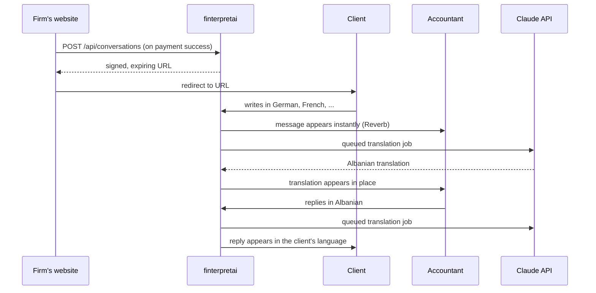

# finterpretai

[](https://github.com/arditxhanaj/finterpretai/actions/workflows/tests.yml)

A live, translated chat between an accounting firm and its foreign clients. The client writes in their own language, the accountant reads and replies in Albanian, and each side sees the other's messages translated, in real time, in one thread.

Built with **Laravel 13, Livewire 4, Laravel Reverb and the Claude API**, and running in production.

**▶ [Watch the 60-second demo](https://youtu.be/MBDZjDN1aLs)**

---

## Why it exists

A small accounting firm in Albania serves clients who mostly don't speak Albanian. Before this app, a client paid for a consultation and then asked their question by email. The answer was written in Albanian, translated by hand, and sent back. That added a day of round trips and a manual translation step to every question.

finterpretai replaces that email loop. The client pays on the firm's existing website and is redirected straight into a live chat. No account, no password.

## How it works



1. **Payment triggers the conversation.** The firm's site makes one server-to-server call to `POST /api/conversations`. The app creates the client (keyed on email, so a returning client stays one record) and a fresh conversation, and returns a signed URL valid for 30 days.
2. **The client needs no account.** The signed URL *is* the access. It's validated by Laravel's `signed` middleware and resolves the conversation by ULID, never by its numeric id.
3. **Messages are live.** Each message is broadcast over WebSockets with Laravel Reverb, so both sides see it immediately.
4. **Translation happens after the response.** A queued job sends the message to Claude, stores the translation, and re-broadcasts it, so the UI shows the original instantly and the translation a moment later. Failures are recorded, not swallowed.

## Features

- Guest access through signed, expiring links. No signup for clients
- Staff dashboard with a live conversation list and thread view, behind Fortify authentication (self-registration disabled)
- Real-time messaging in both directions with Laravel Reverb
- Bidirectional translation with Claude. Direction is chosen from the sender, with tone, accounting terms, numbers and dates preserved
- Per-message translation status: `pending`, `completed`, `failed`
- A single integration endpoint for the payment site, protected by an API key

## Stack

| | |
|---|---|
| Framework | Laravel 13, PHP 8.4 |
| UI | Livewire 4 single-file components, Flux UI, Tailwind |
| Real-time | Laravel Reverb, Laravel Echo |
| AI | Claude API via `anthropic-ai/sdk` |
| Auth | Laravel Fortify (staff), signed routes (clients) |
| Data | PostgreSQL in production, SQLite locally |
| Quality | Pest 5, PHPStan level 7 with Larastan, Pint |
| Hosting | Laravel Cloud, Neon Postgres, GitHub Actions CI |

## Design decisions

The parts that weren't obvious, and why they're built the way they are.

**Two auth strategies for two actors.** Staff log in normally. Clients never do. They hold a signed URL, which is the same security model as a password-reset link. It keeps the client flow to a single redirect, with nothing to remember.

**Guests can't use private broadcast channels, so message events use a public channel keyed by ULID.** Private channels need an authenticated session to authorize, and guest clients don't have one. The channel name contains the conversation's ULID, so knowing the channel means already holding the link. The staff-side `ConversationCreated` event, by contrast, goes over a private channel.

**Translation runs after the response.** `TranslateMessage::dispatch(...)->afterResponse()` keeps the Claude call out of the request cycle without running a separate always-on queue worker in production, which kept hosting costs down for a small client.

**Messages are ordered explicitly.** `Conversation::messages()` orders by `id`. Without it, the `UPDATE` that stores a translation could change physical row order in PostgreSQL, and messages appeared out of sequence. That bug was found in testing.

**Translation state can't be mass-assigned.** `Message::$fillable` deliberately excludes `body_translated` and `translation_status`. Only the job sets them.

**Tests never call the real API.** Because tests run the queue synchronously, `MessageTest` fakes the queue so a test run can't make billable Claude calls.

## Testing and quality

```bash
composer test
```

Runs Pint (style), PHPStan at level 7 with Larastan (types), then the Pest suite: **55 tests** covering signed-link access (valid, unsigned, tampered, expired, missing), the integration API (auth, validation, reusing a client on repeat calls), messaging (sending, validation, queued translation, ordering, cascade deletes), and the Fortify auth flows. The same checks run in GitHub Actions on every push to `main` and every pull request.

## Running locally

Requirements: PHP 8.4, Composer, Node.js.

```bash
git clone https://github.com/arditxhanaj/finterpretai.git
cd finterpretai
composer setup        # install, .env, key, migrate, build assets
```

Fill in the two keys in `.env`. The Reverb settings already have working local defaults:

```dotenv
ANTHROPIC_API_KEY=your-key
INTEGRATION_API_KEY=a-long-random-secret   # protects POST /api/conversations
```

Then run the app and the WebSocket server in two terminals:

```bash
composer dev              # web server, queue worker, Vite
php artisan reverb:start  # WebSockets
```

Self-registration is disabled, so create a staff user with `php artisan tinker`.

## Integration API

One endpoint, called server-to-server when a payment succeeds:

```http
POST /api/conversations
X-API-Key: <INTEGRATION_API_KEY>
Content-Type: application/json
Accept: application/json

{
  "name": "Hans Müller",
  "email": "hans@example.de",
  "locale": "German",
  "subject": "VAT registration for a new business"
}
```

Returns `201` with `{ "url": "..." }`, a signed link to redirect the client to. `403` for a missing or wrong key, `422` for invalid input.

`locale` is an English language **name** (`"German"`), not a code (`"de"`), because it goes straight into the translation prompt.

## What's next

- **AI reply suggestions for staff.** A side panel where Claude drafts a reply from the conversation so far, which the accountant can use, edit or ignore. Suggestions are deliberately never stored. The transcript only ever has two authors, the client and the accountant.
